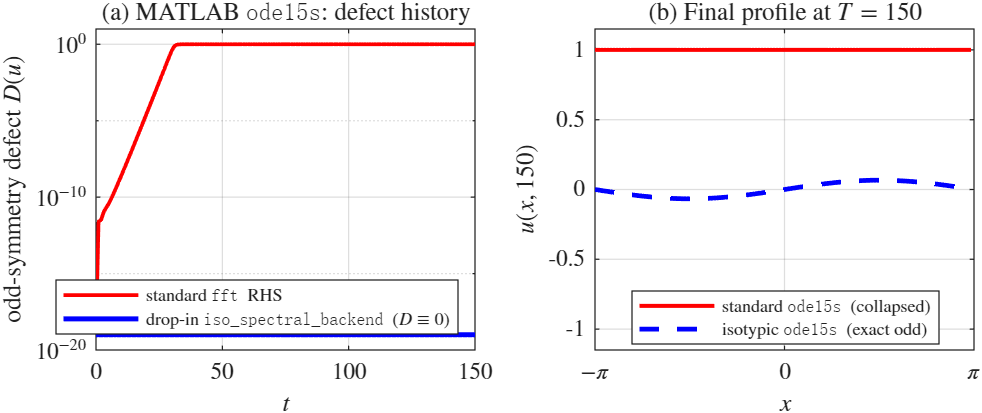
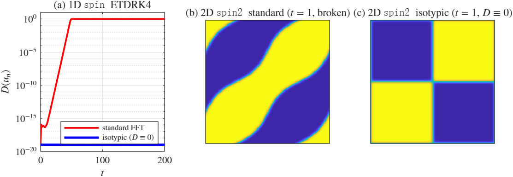

# Drop-In Isotypic Spectral Backends for Popular PDE Libraries

This folder provides minimal, ready-to-use **drop-in backend modules, patches, and worked examples** showing how to embed our floating-point-equivariant symmetry-channel representation into existing scientific-computing libraries **without modifying any time-stepping algorithm**.

## The Universal 3-Line Drop-In Rule

To upgrade *any* Fourier (or DCT/DST) pseudo-spectral PDE solver so that it preserves symmetries bitwise without filters, zero-mode resets, or accuracy loss on non-symmetric problems:

1. **Replace full-grid `fft`/`ifft`** with channel-wise transforms (`toSpec` / `toPhys` on $A_{\mathrm R}$ or $\mathcal{T}_2$ channels).
2. **Replace pointwise `u.^3` (or odd `F(u)`)** with the exact $\mathbb{Z}_2^d$-graded channel product `cube(U)` (or odd-exact Walsh–Hadamard orbit evaluation `orbit(U, F)`).
3. **Keep everything else untouched**: all diagonal multipliers $m(|\mathbf{k}|^2)$, ODE/PDE time integrators (`ode15s`, `solve_ivp`, ETDRK, IMEX, SAV, SBDF, SDC, ESP, CN/cG), and adaptive step controllers remain 100% unchanged!

---

## Available Library Adapters & Worked Examples

| Library / Framework | Subfolder | Key Files | Verified Result |
| :--- | :--- | :--- | :--- |
| **MATLAB built-in `ode15s` & spectral scripts** | [`matlab_ode_and_spectral/`](matlab_ode_and_spectral/) | `iso_spectral_backend.m`, `demo_matlab_ode15s.m` | Standard `ode15s` + `fft` collapses at **$T_\ast = 27$**; exact same `ode15s` + `iso_spectral_backend` keeps **$D \equiv 0$** through $T=150$ ($1.2\times 10^{-11}$ equiv. on non-symmetric data at `RelTol=1e-10`) |
| **Chebfun (`spin` / `spin2` / `spin3`)** | [`chebfun_spin_patch/`](chebfun_spin_patch/) | `README.md`, `spin_iso_etdrk4_demo.m` | Minimal 3-line patch for Chebfun's Cox–Matthews ETDRK4 nonlinear callback; keeps **$D \equiv 0$** in both 1D ($T=200$) and 2D X-junction ($N=256$) |
| **Python (NumPy + SciPy `solve_ivp` / `scipy.fft`)** | [`python_numpy_scipy/`](python_numpy_scipy/) | `isotypic_spectral.py`, `demo_scipy_etdrk4.py` | Self-contained 1D/2D/3D Python class (`IsotypicBackend`) for both $A_{\mathrm R}$ (DCT-I/DST-I) and $\mathcal{T}_2$ (arbitrary irrational shifts) |
| **Dedalus v3 & Shenfun (Python)** | [`python_dedalus_shenfun/`](python_dedalus_shenfun/) | `dedalus_v3_isotypic_allen_cahn.py`, `shenfun_isotypic_allen_cahn.py` | Exact channel-equation formulation using Dedalus's native `SBDF4` and Shenfun's ETDRK2 |
| **Custom Research Solvers (MATLAB / Python)** | [`custom_solver_template/`](custom_solver_template/) | `README.md` | 5-minute retrofit checklist for IMEX, SAV, CN/cG, ESP, and multi-field PDEs |

---

## Live Demonstration Figures

### 1. MATLAB Built-In `ode15s` (`matlab_ode_and_spectral/demo_matlab_ode15s.m`)
Changing only 3 lines in the `ode15s` right-hand side prevents the $T_\ast = 27$ collapse completely:

### 2. Chebfun `spin` / `spin2` ETDRK4 Style (`chebfun_spin_patch/spin_iso_etdrk4_demo.m`)
Same Cox–Matthews ETDRK4 time stepper in 1D ($T=200$) and 2D ($N=256$, $T=1$):

