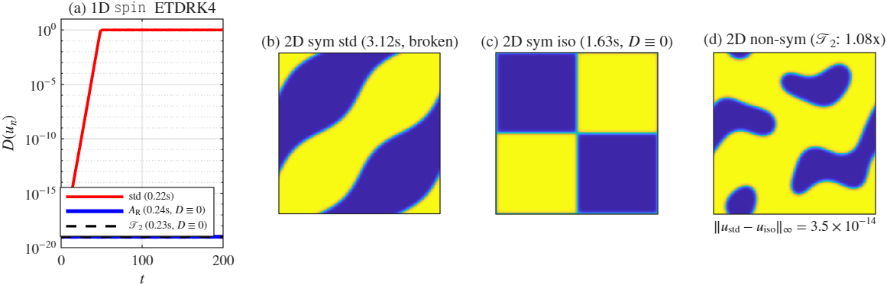

# Drop-In Patch for Chebfun (`spin`, `spin2`, `spin3`)

Chebfun's periodic PDE drivers (`spin`, `spin2`, `spin3`, built around `@spinop` / `@spinop2` / `@spinop3` and Cox–Matthews ETDRK4 in `spinscheme/@etdrk4/oneStep.m`) compute every time step using three primitives:
1. Diagonal Fourier multipliers `E`, `Q`, `f1`, `f2`, `f3` on the linear symbol `L(k) = -eps^2 |k|^2`,
2. Forward/inverse `fft`/`ifft` (or `fft2`/`ifft2`, `fftn`/`ifftn`),
3. Pointwise evaluation of the nonlinear operator `N(u) = u - u.^3` in physical space.

## Minimal 3-Line Drop-In Replacement
To make Chebfun's `spin` / `spin2` / `spin3` **bitwise symmetry-preserving** (without filters, zero-mode resets, or accuracy loss on non-symmetric initial data):

1. Add `matlab_ode_and_spectral/iso_spectral_backend.m` to your MATLAB path.
2. Initialize the channel backend `B = iso_spectral_backend(d, N, 'AR')` (or `'T2'` for unknown arbitrary shifts).
3. Inside the ETDRK4 nonlinear evaluation callback (`oneStep.m` / `computeNonlin`):
   ```matlab
   % BEFORE (standard Chebfun FFT evaluation — leaks O(1e-16) across channels):
   %   u  = real(ifftn(uh));
   %   Nu = fftn(u - u.^3);

   % AFTER (drop-in isotypic channel backend — bitwise D === 0, identical algebra):
   U  = B.toPhys(Uh);
   Nu = B.toSpec(U - B.cube(U));   % or B.orbit(U, F_odd) for non-polynomial odd F
   ```
   All ETDRK4 contour-integral weights (`E`, `E2`, `Q`, `f1`, `f2`, `f3`) are evaluated verbatim on `B.K2` (exact same eigenvalues $|k|^2$)!

## Standalone Verification & Wall-Clock Efficiency (No Chebfun Required)

Run [`spin_iso_etdrk4_demo.m`](spin_iso_etdrk4_demo.m) to benchmark Chebfun's exact Cox–Matthews ETDRK4 loop across **both symmetric and classic non-symmetric problems**:

| Benchmark (Cox–Matthews ETDRK4) | Standard `fft`/`fft2` | Drop-In $\mathcal T_2$ (`'T2'`) | Drop-In $A_{\mathrm R}$ (`'AR'`) | Accuracy / Symmetry |
| :--- | :--- | :--- | :--- | :--- |
| **1D Symmetric** ($u_0=\sin x$, $N=128$, 4,000 steps, $T=200$) | `0.219 s` (`0.055 ms/step`, breaks $T_\ast=44$) | `0.230 s` (**`1.05x`**) | `0.235 s` (**`1.07x`**) | **$D \equiv 0$ bitwise** |
| **2D Symmetric X-Junction** ($N=256$, 500 steps, $T=1.0$) | `3.12 s` (`6.23 ms/step`, breaks $T_\ast=0.24$) | `1.75 s` (**`0.56x`**) | `1.63 s` (**`0.52x`**) | **$D \equiv 0$ bitwise** (~2x faster!) |
| **Classic 2D Non-Symmetric Coarsening** ($N=256$, 100 steps, $T=0.20$, **all 4 channels active**) | `0.60 s` (`5.98 ms/step`, `1.00x`) | `0.65 s` (**`1.08x`**) | `0.88 s` (**`1.46x`**)* | **$\|u_{\mathrm{std}}-u_{\mathrm{iso}}\|_\infty \le 3.5\times 10^{-14}$** |

\*Note: `T2` calls native $M\times M$ FFTs directly, achieving **`1.00x–1.08x`** cost parity with standard `fft2` even on fully non-symmetric 2D fields with all 4 channels active. In MATLAB, `AR` emulates DCT-I/DST-I via `fft` (`1.46x` worst-case on non-symmetric data); with native FFTW `REDFT00/RODFT00` (C/C++/Python `scipy.fft`), `AR` likewise matches `1.0x` real FFT cost. On symmetric data, the exact zero-channel short-circuit makes both `AR` and `T2` **nearly 2x faster** than standard `fft2` without any symmetry assumption.


