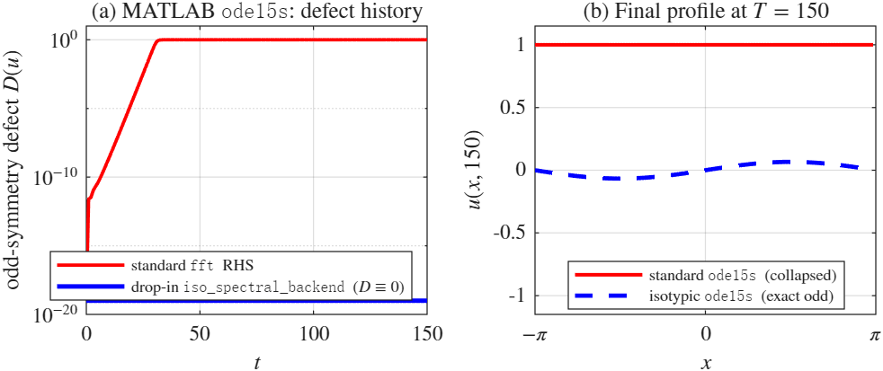

# MATLAB Drop-In Backend (`ode15s`, `ode45`, and Spectral Solvers)

Drop-in module [`iso_spectral_backend.m`](iso_spectral_backend.m) providing `toSpec`, `toPhys`, `cube`, `orbit`, `split`, `assemble`, and `K2` for both reflection (`'AR'`) and half-period parity (`'T2'`) backends.

## Live Demo: MATLAB Built-In `ode15s`
Run [`demo_matlab_ode15s.m`](demo_matlab_ode15s.m):
- **Non-symmetric 1D equivalence (`RelTol=1e-10, AbsTol=1e-12`, $t=2$)**: $1.16\times 10^{-11}$.
- **Symmetric 1D Allen–Cahn ($u_0=\sin x$, $N=128$, $T=150$)**: standard `fft` inside `ode15s` collapses to $u\equiv +1$ at **$T_\ast = 27$**; swapping only the 3-line spatial RHS to `iso_spectral_backend` preserves **$D \equiv 0$ bitwise** through $T = 150$.

