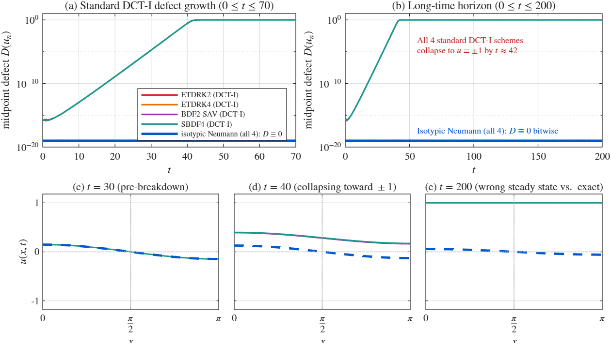
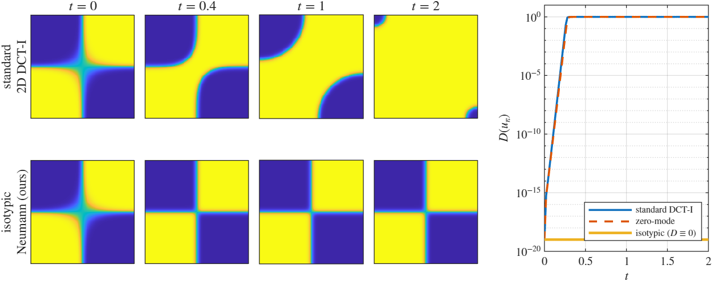
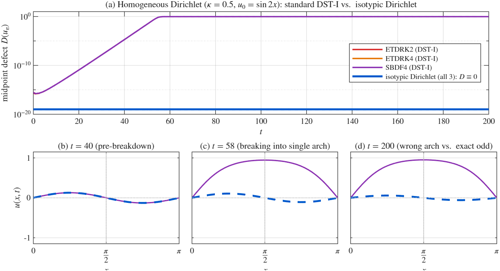

# Supplementary Boundary-Condition Evidence: Homogeneous Neumann & Homogeneous Dirichlet Problems

This folder provides self-contained, runnable MATLAB verification scripts and comparison figures demonstrating that:
1. **Midpoint odd symmetry is rigorously preserved by the continuous PDE** under both **homogeneous Neumann** ($\partial_n u|_{\partial\Omega}=0$) and **homogeneous Dirichlet** ($u|_{\partial\Omega}=0$) boundary conditions on $\Omega = [0,\pi]^d$.
2. **Standard cosine (DCT-I) and sine (DST-I) spectral solvers—and even a posteriori zero-mode suppression in 2D—all suffer catastrophic symmetry breaking** under floating-point arithmetic, collapsing to wrong steady states.
3. **Our half-domain midpoint-isotypic channel splitting** on $[0,\pi/2]^d$ (even vs. odd wavenumber channels, exact $\mathbb{Z}_2^d$-graded cubic product, zero filtering) is algebraically identical to standard DCT/DST on general non-symmetric data ($1.4\times 10^{-16}\text{--}2.8\times 10^{-16}$) yet preserves midpoint odd symmetry **bitwise ($D \equiv 0$)** across all tested integrators.

---

## Summary of Verified Results

| Benchmark | Script | Non-sym. equiv. | Standard DCT/DST breakdown | Isotypic backend (ours) |
| :--- | :--- | :---: | :--- | :---: |
| **1D Homogeneous Neumann** ($u_0=\cos x$, $N=128$, $T=200$) | [`bc_neumann_1d.m`](bc_neumann_1d.m) | $1.39\times 10^{-16}$ | ETDRK2, ETDRK4, BDF2-SAV, SBDF4 **all break at $T_\ast = 37.00$** and collapse to $u \equiv +1$ | **$D \equiv 0$ bitwise** (all 4 integrators) |
| **2D Homogeneous Neumann X-junction** ($N=192$, $\varepsilon=0.05$, $T=2$) | [`bc_neumann_2d.m`](bc_neumann_2d.m) | $1.11\times 10^{-16}$ | Standard 2D DCT-I breaks at **$T_\ast = 0.24$**; DCT-I + zero-mode suppression breaks at **$T_\ast = 0.26$** ($u \to +1$) | **$D \equiv 0$ bitwise** (4-quadrant checkerboard intact) |
| **1D Homogeneous Dirichlet** ($\kappa=0.5$, $u_0=\sin 2x$, $N=128$, $T=200$; *no $k=0$ mode!*) | [`bc_dirichlet_1d2d.m`](bc_dirichlet_1d2d.m) | $2.78\times 10^{-16}$ | ETDRK2, ETDRK4, SBDF4 (DST-I) **all break at $T_\ast = 49.00$** and collapse into a positive single arch ($u(\pi/2)=+0.952$) | **$D \equiv 0$ bitwise** (all 3 integrators) |

---

## Visual Comparisons

### 1. 1D Homogeneous Neumann Allen–Cahn (`bc_neumann_1d.m`)
All four standard DCT-I integrators collapse to $u \equiv +1$ by $t \approx 42$, while our midpoint-isotypic Neumann backend preserves the exact odd cosine wave through $T = 200$:



### 2. 2D Homogeneous Neumann X-Junction (`bc_neumann_2d.m`)
Standard 2D DCT-I (and zero-mode suppression!) dissolves the negative quadrants and floods the domain with $+1$ by $t = 2$, while our 4-channel isotypic Neumann backend maintains $D \equiv 0$ bitwise:



### 3. 1D Homogeneous Dirichlet Allen–Cahn (`bc_dirichlet_1d2d.m`)
Even with **no constant ($k=0$) mode**, the unstable midpoint-even mode $\sin(x)$ ($\lambda_\perp = 1-\kappa^2 = 0.75$) causes standard DST-I integrators to collapse into a single-sign arch by $T_\ast = 49$, while our 2-channel isotypic Dirichlet backend maintains $D \equiv 0$ bitwise:



---

## Intellectual Property & Citation

Copyright © 2026 **Minghui Li** and **Zixian Liu** (School of Mathematical Sciences, Jiangxi Science and Technology Normal University), released under the [MIT License](../LICENSE). If you reuse or adapt these Neumann/Dirichlet symmetry-channel scripts, algorithms, or comparison benchmarks in your research or publications, **please retain the copyright notice and cite our paper**:

```bibtex
@article{LiLiu2026Isotypic,
  author  = {Minghui Li and Zixian Liu},
  title   = {Exact long-time symmetry preservation in phase-field simulations:
             isotypic spectral schemes that are equivariant in floating-point arithmetic},
  year    = {2026},
  note    = {Submitted to Journal of Computational Physics; code available at
             \url{https://github.com/minghuili123456789/isotypic-phase-field}}
}
```
